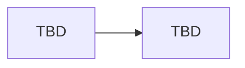

# Implementation Walkthrough

Last updated: 2026-10-30  
Assignment received: **NO**  
Rule: describe only code that exists. If a component is partial or missing, say so.

---

## Architecture (fill after scaffold)



---

## Components

_None yet._

Per-component template:

```text
### <Component>
- Responsibility:
- Important files:
- Important classes / functions:
- Execution flow:
- Inputs / outputs:
- Dependencies:
- Failure behavior:
- Testing:
- Limitations:
```

---

## End-to-end flow

_Not implemented._

---

## Known gaps vs the brief

_None until the brief exists._
