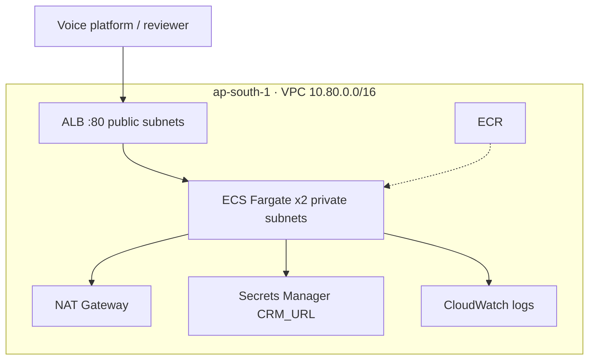
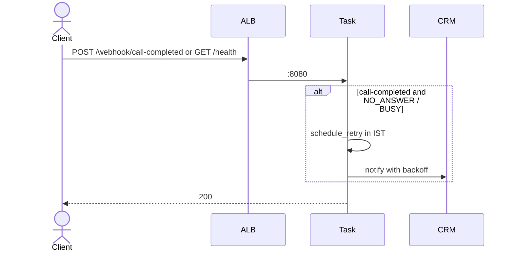

# manan-predixion

Private submission for Predixion AI engineering assignments (Manan Paliwal). Python 3.12.

Part A lives in `assignmentN/part_a/` (candidate-owned, not edited by AI). Part B uses it where the brief says to: A3 imports `schedule_retry` / `notify_crm`; A4 loads the rewritten system prompt. A1 ledger implements the A3.4 unique `gateway_txn_id` rule; A2 analysis is a separate extract from Part A’s capacity/A/B/funnel.

## Run each Part B

```bash
# 1 Collections ledger
cd assignment1 && python3.12 -m venv .venv && source .venv/bin/activate && pip install -r requirements.txt && pytest

# 2 Dialer analytics
cd assignment2 && python3.12 -m venv .venv && source .venv/bin/activate && pip install -r requirements.txt && python analyze.py && pytest

# 3 Webhook
cd assignment3 && python3.12 -m venv .venv && source .venv/bin/activate && pip install -r requirements.txt && pytest
# docker build/run when Docker Desktop is up
# live: http://predixion-call-webhook-alb-1459486561.ap-south-1.elb.amazonaws.com/health

# 4 Collections agent
cd assignment4 && python3.12 -m venv .venv && source .venv/bin/activate && pip install -r requirements.txt && python eval.py && pytest
```

## Assignment 3 AWS (ap-south-1)

Full labels, IAM split, and teardown: [`assignment3/README.md`](assignment3/README.md).

Internet never reaches the tasks. The ALB is public; Fargate runs in private subnets and talks to the CRM through NAT. `CRM_URL` comes from Secrets Manager at task start.




