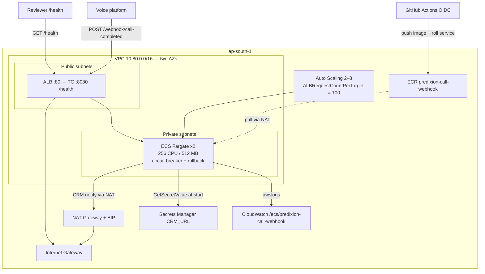
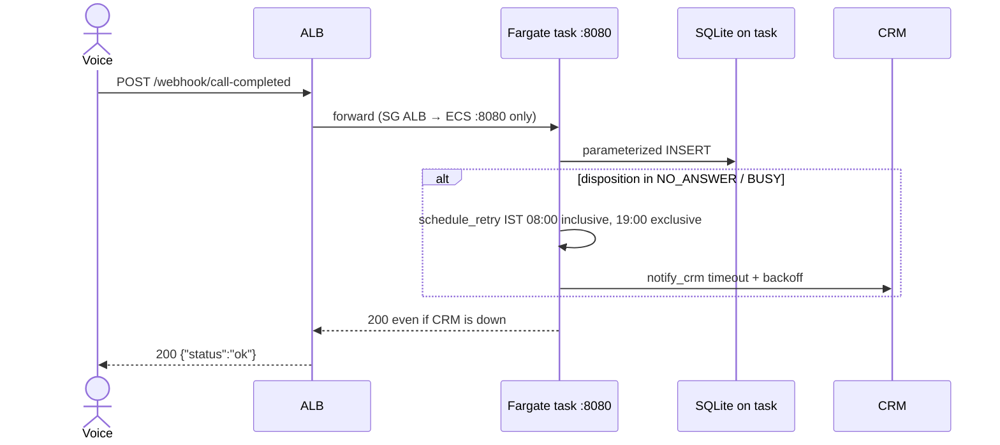
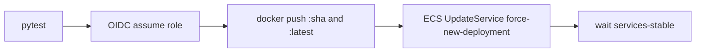

# Assignment 3 — Fix and Ship (Part B)

Production webhook service. **Part B imports the corrected `schedule_retry` / CRM notify / retryable dispositions from `part_a/A3_partA_manan.py`.** Do not edit Part A from the assistant.

## App

- FastAPI + Pydantic `CallCompleted`
- `GET /health`
- JSON logs
- `schedule_retry` in IST, window 08:00–19:00, gaps `[30, 120, 240]` minutes
- Parameterized SQLite inserts; CRM notify with timeout and 3 attempts

```bash
cd assignment3
python3.12 -m venv .venv
source .venv/bin/activate
pip install -r requirements.txt
pytest
uvicorn app.main:app --port 8080
```

## Docker

```bash
docker build -t call-webhook .
docker run --rm -p 8080:8080 call-webhook
curl -s http://127.0.0.1:8080/health
```

## AWS architecture (what is running)

Account `660442155240`, region **ap-south-1**. Terraform in `terraform/` created this stack (31 resources). Tasks stay in **private subnets** (no public IP). Phone numbers never leave India.



| Piece | Why it is there |
|---|---|
| ALB in public subnets | Only public ingress; HTTP :80 → target group IP mode on :8080 |
| Fargate in private subnets | App + SQLite + PII not on the internet; outbound through NAT |
| Secrets Manager `CRM_URL` | Injected as env; **task execution role** may `GetSecretValue` on that one secret |
| Task role | Present, empty — the process does not call AWS APIs |
| CloudWatch | JSON app logs, 14-day retention |
| Auto Scaling 2–8 | `ALBRequestCountPerTarget` target 100 |
| Deployment circuit breaker | Failed deploys roll back |
| ECR | Image `predixion-call-webhook:latest` (and git SHA tags from Actions) |

Live health: http://predixion-call-webhook-alb-1459486561.ap-south-1.elb.amazonaws.com/health

### Request flow



ALB also probes `GET /health` every 30s (`matcher 200`). Unhealthy tasks are replaced; a bad deploy trips the circuit breaker.

### Ship flow (CI)

Push/PR runs **tests only**. **Actions → assignment3-webhook → Run workflow** does the rest (OIDC role `predixion-call-webhook-gha`, no long-lived keys):



`terraform apply` is **local only**. GitHub does not have `terraform.tfstate`.

```bash
cd terraform
terraform init
terraform validate
terraform plan
```

Tear down today:

```bash
cd terraform
AWS_PROFILE=default terraform destroy -auto-approve
```
